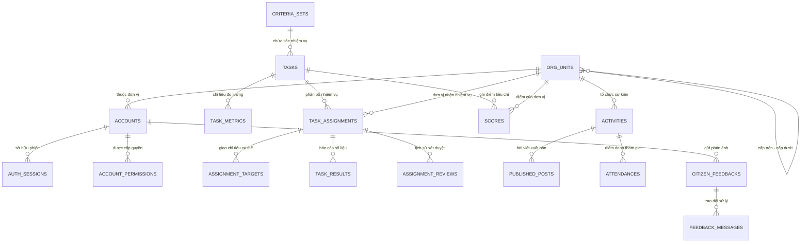

# TÀI LIỆU TOÀN DIỆN VỀ KIẾN TRÚC, LOGIC CODE, CHỨC NĂNG VÀ QUY TRÌNH LƯU TRỮ DATABASE POSTGRESQL
## CỔNG THÔNG TIN THANH NIÊN TRƯỜNG HỌC (TNTH)

---

## 1. TỔNG QUAN HỆ THỐNG & CÔNG NGHỆ (ARCHITECTURE & TECH STACK)

### 1.1. Công nghệ sử dụng
- **Framework & Runtime**: Next.js 16.3.5 (App Router, Turbopack, React 19, Node.js runtime).
- **Ngôn ngữ**: TypeScript 5 (Strict type checking, zero `any` unsafe).
- **Cơ sở dữ liệu (RDBMS)**: PostgreSQL (kết nối qua SSH Tunnel bảo mật tới máy chủ cơ sở dữ liệu `103.179.189.172:5432`, cổng local `5433`).
- **Giao tiếp Database**: Driver `pg` (Pool kết nối bền vững, Transaction isolation, parameterized queries chống SQL Injection).
- **Styling & UI**: Tailwind CSS v3, Lucide Icons, Headless UI pattern, Canvas Confetti.
- **Xử lý tài liệu**: ExcelJS (nhập/xuất file Excel `.xlsx` với Data Validation dropdown native).

### 1.2. Kiến trúc dữ liệu kép (Hybrid State Architecture)
Hệ thống kết hợp giữa **Server-side PostgreSQL** làm nguồn sự thật duy nhất (Single Source of Truth) và **Client-side React Context (`StoreContext`)** giúp giao diện phản hồi tức thì (Optimistic UI):
1. **Hydration khởi động**: Khi trình duyệt tải trang, `StoreContext` lập tức gọi `GET /api/store` và `GET /api/org-units` để kéo toàn bộ dữ liệu thật từ DB về bộ nhớ client.
2. **Lưu trữ tức thời (Persistence)**: Mọi thao tác thêm/sửa/xoá trên UI đều cập nhật state trong bộ nhớ và ghi nhận thay đổi (thêm mới, cập nhật, hoặc đưa vào danh sách tombstone).
3. **Đồng bộ ngầm (Background Sync)**: Client chỉ đẩy **dòng mới/đổi** (và id đã xoá) lên `POST /api/store` — sau khoảng 1,2 giây yên tĩnh, hoặc ngay khi rời trang/ẩn tab — để ghi vào PostgreSQL bằng cơ chế **UPSERT** và xóa theo **Tombstones ngược khóa ngoại**. Vòng 30 giây (`SYNC_POLL_MS`) chỉ là chiều **nạp lại** từ server (bỏ qua khi tab ẩn hoặc máy còn thay đổi chờ gửi). Chi tiết ở mục 4.4.
4. **Không mất dữ liệu khi F5**: Vì dữ liệu được lưu vĩnh viễn trong PostgreSQL và tự động nạp lại khi mount, việc F5 hay chuyển đổi thiết bị đều giữ trọn vẹn 100% dữ liệu.
5. **Không dùng dữ liệu ảo (Zero Fake/Mock Data)**: Toàn bộ bảng nhiệm vụ, kết quả báo cáo, chỉ tiêu phân bổ và điểm thi đua đều lấy từ dữ liệu thực tế do người dùng tạo.

---

## 2. CƠ CHẾ PHÂN QUYỀN & BẢO MẬT (AUTH & PERMISSION MATRIX)

### 2.1. Phân cấp 5 tầng tổ chức Đoàn TNCS Hồ Chí Minh
| Cấp bậc | Mã cấp | Tên cấp tổ chức | Ví dụ thực tế | Quyền hạn tiêu biểu |
| :--- | :---: | :--- | :--- | :--- |
| **Cấp 1** | `1` | Trung ương Đoàn | Ban Bí thư TW Đoàn, Ban Thanh niên Trường học TW | Quản trị toàn hệ thống, ban hành tiêu chí thi đua toàn quốc, chấm điểm 39 đơn vị cấp 2, duyệt toàn quyền cây tổ chức. |
| **Cấp 2** | `2` | Tỉnh / Thành đoàn & Đoàn trực thuộc TW | 34 Tỉnh/Thành đoàn (Lào Cai, Tuyên Quang, Hà Nội, TP.HCM...) + 5 Đoàn trực thuộc TW (Quân đội, Công an, Chính phủ, Khối CQ TW, Mặt trận) | Nhận chỉ tiêu từ TW, phân bổ xuống huyện/trường, chấm điểm cho các đơn vị cấp dưới trực thuộc tỉnh mình, quản lý cây đơn vị nội tỉnh. |
| **Cấp 3** | `3` | Đoàn cấp trên cơ sở | Huyện/Thị/Thành đoàn, Đoàn Đại học Quốc gia | Quản trị các cơ sở Đoàn trực thuộc địa bàn/trường cụm. |
| **Cấp 4** | `4` | Đoàn cơ sở | Đoàn Trường THPT, Đoàn Trường Đại học/Cao đẳng, Đoàn Xã/Phường | Nhận chỉ tiêu, tổ chức hoạt động, điểm danh sinh hoạt, gửi báo cáo thi đua lên cấp trên. |
| **Cấp 5** | `5` | Chi đoàn | Chi đoàn lớp 12A1, Chi đoàn thôn/khu phố | Sinh hoạt đoàn, quản lý hồ sơ đoàn viên. |

### 2.2. Vai trò người dùng (User Roles)
- `QUAN_TRI_TW`: Quản trị viên Trung ương Đoàn (Toàn quyền hệ thống).
- `QUAN_TRI_TINH`: Cán bộ Quản trị Tỉnh/Thành đoàn hoặc Đoàn trực thuộc TW.
- `QUAN_TRI_CAP3`: Cán bộ Đoàn cấp Huyện/Thị/Đoàn cấp trên cơ sở.
- `QUAN_TRI_DON_VI`: Bí thư/Phó Bí thư Đoàn trường THPT, ĐH, CĐ, Đoàn xã.
- `DOAN_VIEN`: Đoàn viên, thanh niên, học sinh, sinh viên (quyền xem tin, học tập, gửi phản ánh, thi trực tuyến, nộp hồ sơ HS3T).

### 2.3. Ma trận quyền hạn chi tiết (Permission Engine)
Hệ thống sử dụng cơ chế quyền kép: **Role mặc định** + **Granted Permissions bổ sung** theo tài khoản (lưu tại bảng `account_permissions`).
- `system.orgtree.manage`: Toàn quyền thêm, sửa, xoá, import cây đơn vị.
- `system.orgtree.view`: Xem sơ đồ tổ chức.
- `accounts.manage`: Tạo mới và phân quyền tài khoản cấp dưới.
- `tasks.assign`: Phân bổ chỉ tiêu thi đua cho cấp dưới.
- `tasks.report`: Báo cáo số liệu thực hiện nhiệm vụ.
- `tasks.review`: Xác nhận/Từ chối báo cáo số liệu của cấp dưới.
- `scores.manage`: Chấm điểm thi đua và xuất bản bảng xếp hạng.
- `posts.manage`: Đăng và biên tập tin tức, bài viết.
- `activities.manage`: Tạo sự kiện, tạo mã QR điểm danh.

---

## 3. CẤU TRÚC THƯ MỤC & LOGIC CHI TIẾT TỪNG FILE CODE

```
tnth-website/
├── scripts/
│   ├── keep-tunnel.ps1          # Daemon tự phục hồi SSH Tunnel kết nối DB
│   └── test-connection.js       # Kiểm tra kết nối PostgreSQL
├── src/
│   ├── app/                     # Next.js App Router (Giao diện & API)
│   │   ├── (dashboard)/         # Vùng quản trị nội bộ (/quan-tri)
│   │   ├── api/                 # 19 REST API endpoints
│   │   ├── [public routes]/     # Các trang thông tin công khai
│   │   └── layout.tsx & page.tsx# Layout gốc & Trang chủ cổng thông tin
│   ├── components/              # Các UI component dùng chung
│   │   ├── ui/                  # Button, Badge, Modal, Card, Table, Input...
│   │   └── layout/              # Header, Footer, Navigation, Breadcrumbs
│   ├── data/                    # Dữ liệu danh mục nền (chức danh, loại trường)
│   ├── lib/                     # Thư viện lõi, DB pool, Store Context, Auth
│   └── types/                   # TypeScript Type Definitions
```

### 3.1. Thư mục Lõi (`src/lib/`)

#### `src/lib/db.ts`
- **Chức năng**: Khởi tạo và quản lý connection pool PostgreSQL.
- **Logic**:
  - Đọc biến môi trường `PGHOST`, `PGPORT`, `PGUSER`, `PGPASSWORD`, `PGDATABASE`.
  - Thiết lập `max: 10`, `idleTimeoutMillis: 30000`, `connectionTimeoutMillis: 5000`.
  - Cung cấp hàm `query<T>(sql, params)` nhận generic type an toàn, tự động giải phóng client về pool.
  - Cung cấp hàm `dbEnabled()` để kiểm tra kết nối DB có sẵn sàng hay không.

#### `src/lib/server/auth.ts`
- **Chức năng**: Quản lý phiên đăng nhập (Session Management) và bảo mật phía máy chủ.
- **Logic**:
  - Sử dụng cookie HTTP-only mang tên `tnth_session`.
  - Lưu phiên đăng nhập tại bảng `auth_sessions` trong PostgreSQL với thời hạn mặc định 7 ngày.
  - Hàm `sessionFromToken(token)` kiểm tra tính hợp lệ của token, tra cứu `accounts`, kiểm tra tài khoản có bị khóa hoặc xóa mềm hay không (`is_active = true AND deleted_at IS NULL`).
  - Hàm `hashPassword(plain)` và `verifyPassword(plain, hash)` sử dụng thuật toán băm chuẩn công nghiệp.

#### `src/lib/server/store-tables.ts`
- **Chức năng**: "Trái tim" của cơ chế đồng bộ PostgreSQL ↔ Client Store.
- **Logic chi tiết**:
  - Định nghĩa `ENTITY_SPECS` cho hơn 30 bảng trong cơ sở dữ liệu: `criteriaSets`, `tasks`, `taskMetrics`, `taskAssignments`, `assignmentTargets`, `taskResults`, `assignmentReviews`, `scores`, `activities`, `publishedPosts`, `documents`, `feedbacks`, `hs3tProfiles`, `quizExams`...
  - **Kiểu dữ liệu**: Chuyển đổi hai chiều giữa kiểu JavaScript (`Date`, `number`, `boolean`, `array`, `object`) và kiểu PostgreSQL (`date`, `timestamptz`, `numeric`, `bigint`, `text`, `jsonb`, `bigint[]`).
  - **Hàm `writeEntity`**: Nhận danh sách bản ghi từ client, thực thi câu lệnh SQL `INSERT ... ON CONFLICT (id) DO UPDATE SET ...` (UPSERT). Điều này đảm bảo khi bản ghi đã tồn tại trong DB, các trường thay đổi sẽ được cập nhật thay vì báo lỗi trùng khóa.
  - **Hàm `deleteEntityIds`**: Xóa bản ghi theo danh sách ID (Tombstone). Server thực thi xóa theo **thứ tự ngược của khóa ngoại** (`ENTITY_ORDER.reverse()`) để đảm bảo không bị lỗi vi phạm ràng buộc Foreign Key.
  - **Hàm `buildDeriveCtx`**: Tự động điền các trường bắt buộc (như `created_by_account_id`) dựa theo đơn vị để đảm bảo toàn vẹn dữ liệu.

#### `src/lib/store-context.tsx`
- **Chức năng**: Quản lý state tập trung cho toàn bộ ứng dụng ở phía client (`StoreContext`).
- **Logic chi tiết**:
  - Cung cấp hook `useStore()` truy xuất mọi danh mục dữ liệu.
  - Tự động nạp dữ liệu lần đầu khi mount (`refreshSnapshot()` và `refreshOrgUnits()`).
  - Bộ theo dõi dòng (`baseRef`/`pendingRef`) gom dòng mới/đổi để gửi lên server; vòng nền 30 giây nạp lại snapshot từ server. `adoptServerRows(entity, rows)` đưa dòng do API riêng trả về vào state và đánh dấu đã khớp DB. Xem mục 4.4.
  - Hỗ trợ hàm tìm kiếm theo cây: `orgById()`, `orgName()`, `childrenOf()`, `scopeIds()`, `isDescendant()`.
  - Hàm tính toán tiến độ: `targetOf()`, `resultsOf()`, `latestReviewOf()`, `unitScore()`.

#### `src/lib/permissions.ts`
- **Chức năng**: Xử lý logic ủy quyền và kiểm tra đặc quyền người dùng.
- **Logic**:
  - Hàm `effectivePermissions(account)`: Tổng hợp toàn bộ quyền từ Role gốc và danh sách Granted Permissions cụ thể.
  - Hàm `hasPerm(perms, required)`: Kiểm tra tài khoản có quyền `required` hoặc sở hữu quyền quản trị tối cao `*`.

---

### 3.2. Nhóm API Endpoints (`src/app/api/`)

#### 1. `GET & POST /api/store`
- **Nhiệm vụ**: Đồng bộ hai chiều giữa DB và bộ nhớ Client.
- **GET**:
  - Khách vãng lai: Chỉ đọc các entity công khai (tin tức, hoạt động, danh bạ...).
  - Đoàn viên: Đọc dữ liệu công khai + dữ liệu cá nhân (phản ánh, hồ sơ HS3T của mình).
  - Cán bộ quản trị: Đọc đầy đủ các bảng quản trị thi đua, phân công, duyệt báo cáo.
- **POST**:
  - Nhận payload `{ entities, deletes }`.
  - Mở một Transaction PostgreSQL (`BEGIN`).
  - Ghi các bản ghi qua hàm `writeEntity` (UPSERT).
  - Xóa các bản ghi qua hàm `deleteEntityIds` (Reverse order).
  - Tự động reset chuỗi sequence: `setval(pg_get_serial_sequence(table, 'id'), max(id))`.
  - Commit transaction hoặc Rollback nếu có bất kỳ lỗi nào phát sinh.

#### 2. `GET, POST, PATCH, DELETE /api/org-units`
- **Nhiệm vụ**: Quản lý cây đơn vị tổ chức 5 cấp.
- **GET**: Trả về toàn bộ danh sách đơn vị đang hoạt động theo đường dẫn thứ bậc (`path`).
- **POST**:
  - Kiểm tra quyền: Chỉ `QUAN_TRI_TW` và `QUAN_TRI_TINH` được tạo đơn vị.
  - Tỉnh Đoàn bị giới hạn nghiêm ngặt: chỉ được tạo cấp dưới bên trong địa bàn tỉnh mình (`path.startsWith('/1/<orgUnitId>/')`).
  - Tự động sinh mã đơn vị không dấu duy nhất (`code`).
  - Tính toán `depth = parent.depth + 1` và `path = parent.path + newId + '/'`.
- **PATCH**: Cập nhật tên đơn vị, tên viết tắt, đơn vị hành chính, loại trường, địa chỉ, trạng thái hoạt động.
- **DELETE**: Xóa mềm đơn vị (`deleted_at = now()`), kiểm tra ràng buộc xem đơn vị có đơn vị con hoặc có tài khoản đang liên kết hay không trước khi xóa.

#### 3. `GET /api/org-units/template`
- **Nhiệm vụ**: Xuất file Excel mẫu (`mau-nhap-don-vi.xlsx`) để nhập cây đơn vị hàng loạt.
- **Cấu trúc Sheets**:
  - `DonVi`: Các cột dữ liệu gồm: `Tên tổ chức *`, `Đơn vị cấp trên *`, `Tên viết tắt`, `Đơn vị hành chính`, `Loại trường (nếu trường học)`, `Địa chỉ`. Đã loại bỏ hoàn toàn cột "Loại tổ chức" theo yêu cầu.
  - `DanhMuc`: Chứa danh sách đơn vị cấp trên (lấy động từ DB tại thời điểm tải) và danh mục các loại trường.
  - `HuongDan`: Hướng dẫn cán bộ cách chọn đơn vị cấp trên từ dropdown thay vì gõ tay.
- **Data Validation**: Cài đặt dropdown trực tiếp trên Excel cho cột B (Cấp trên) và cột E (Loại trường).

#### 4. `GET, POST /api/accounts` & `/api/accounts/[id]`
- **Nhiệm vụ**: Quản lý danh sách tài khoản, hồ sơ người dùng.
- **Logic**: Kiểm tra quyền quản trị, mã hóa mật khẩu bằng bcrypt, hỗ trợ gán đơn vị tổ chức, gán chức danh công tác Đoàn và kích hoạt/khóa tài khoản.

#### 5. `GET, PUT /api/accounts/[id]/permissions`
- **Nhiệm vụ**: Quản lý ma trận phân quyền nâng cao cho từng tài khoản cụ thể.

#### 6. `POST /api/auth/login`, `logout`, `session`, `register`
- **Nhiệm vụ**: Quản trị xác thực người dùng, cấp phát và thu hồi cookie `tnth_session`.

---

### 3.3. Các trang Quản trị Nghiệp vụ (`src/app/(dashboard)/quan-tri/`)

#### 1. Cây đơn vị tổ chức (`he-thong/don-vi/page.tsx`)
- **Phân cấp giao diện**:
  - Quản trị Trung ương Đoàn: Nhìn thấy toàn bộ cây tổ chức bắt đầu từ TW Đoàn (ID 1).
  - Quản trị Tỉnh Đoàn: Chỉ nhìn thấy cây tổ chức thuộc phạm vi tỉnh của mình (Root = đơn vị tỉnh, ví dụ: Tỉnh Đoàn Lào Cai, Nghệ An...).
- **Tính năng**:
  - Thêm mới đơn vị con: Cấp tổ chức tự động tính toán bằng cấp của cha + 1.
  - Đã loại bỏ hoàn toàn trường "Loại tổ chức" cả trong form thêm/sửa và bảng hiển thị.
  - Nhập file Excel thông minh: Đọc file `.xlsx`, tự động so khớp tên đơn vị cấp trên và tạo cây lồng nhau theo thứ tự.
  - Xuất bản đồ tổ chức thời gian thực.

#### 2. Quản lý Tài khoản & Phân quyền (`he-thong/tai-khoan` & `phan-quyen`)
- Tạo tài khoản cán bộ theo đơn vị.
- Tự động ẩn các chuyên mục, menu mà tài khoản không có quyền truy cập.

#### 3. Bộ tiêu chí & Cây nhiệm vụ (`nhiem-vu/page.tsx`)
- Hiển thị bộ tiêu chí thi đua do TW Đoàn ban hành.
- Phân rã nhiệm vụ đa tầng: Tiêu chí chính → Nhiệm vụ cụ thể → Chỉ tiêu đo lường.
- Hỗ trợ xem nhiệm vụ được giao riêng cho đơn vị mình.
- Cho phép đơn vị cấp dưới nhập báo cáo kết quả, đính kèm minh chứng và đánh dấu hoàn thành.

#### 4. Phân bổ chỉ tiêu cho cấp dưới (`nhiem-vu/phan-cong/[id]/page.tsx`)
- Giao diện giúp cấp trên (TW hoặc Tỉnh) phân bổ chỉ tiêu xuống các đơn vị trực thuộc.
- Không có dữ liệu ảo: Chỉ hiện các đơn vị thực tế có trong DB.

#### 5. Hàng đợi Xác nhận Báo cáo (`nhiem-vu/xac-nhan/page.tsx`)
- Cấp trên duyệt báo cáo do cấp dưới gửi lên.
- **Logic lọc thông minh**: Chỉ những nhiệm vụ nào mà cấp dưới **thực sự đã báo cáo số liệu** (`completionRate > 0`, `status === 'COMPLETED'` hoặc có bản ghi trong `taskResults`) mới xuất hiện trong hàng đợi. Tránh tuyệt đối hiện tượng xuất hiện các báo cáo ảo khi cấp dưới chưa hề thao tác.
- Thao tác: Bấm "Xác nhận" (điểm tự động cộng vào phiếu chấm) hoặc "Yêu cầu giải trình/Bổ sung".

#### 6. Chấm điểm thi đua (`nhiem-vu/cham-diem/page.tsx`)
- **Phân cấp chấm điểm chuẩn xác**:
  - **Tài khoản Trung ương Đoàn**: Chấm điểm cho đúng **39 đơn vị cấp dưới trực tiếp** bao gồm 34 Tỉnh/Thành đoàn và 5 Đoàn trực thuộc TW:
    1. Tỉnh Tuyên Quang
    2. Tỉnh Lào Cai
    3. Tỉnh Thái Nguyên
    4. Tỉnh Phú Thọ
    5. Tỉnh Bắc Ninh
    6. Tỉnh Hưng Yên
    7. Thành phố Hải Phòng
    8. Tỉnh Ninh Bình
    9. Tỉnh Quảng Trị
    10. Thành phố Đà Nẵng
    11. Tỉnh Quảng Ngãi
    12. Tỉnh Gia Lai
    13. Tỉnh Khánh Hoà
    14. Tỉnh Lâm Đồng
    15. Tỉnh Đắk Lắk
    16. Thành phố Hồ Chí Minh
    17. Tỉnh Đồng Nai
    18. Tỉnh Tây Ninh
    19. Thành phố Cần Thơ
    20. Tỉnh Vĩnh Long
    21. Tỉnh Đồng Tháp
    22. Tỉnh Cà Mau
    23. Tỉnh An Giang
    24. Thành phố Hà Nội
    25. Thành phố Huế
    26. Tỉnh Lai Châu
    27. Tỉnh Điện Biên
    28. Tỉnh Sơn La
    29. Tỉnh Lạng Sơn
    30. Tỉnh Quảng Ninh
    31. Tỉnh Thanh Hoá
    32. Tỉnh Nghệ An
    33. Tỉnh Hà Tĩnh
    34. Tỉnh Cao Bằng
    35. Ban Thanh niên Quân đội
    36. Ban Thanh niên Công an Nhân dân
    37. Đoàn Thanh niên Chính phủ
    38. Đoàn thanh niên các Cơ quan Đảng Trung ương
    39. Đoàn thanh niên Mặt trận Tổ quốc Việt Nam
  - **Tài khoản Tỉnh Đoàn**: Hệ thống tự động lọc danh sách đơn vị được chấm thành **các đơn vị cấp dưới trực thuộc tỉnh mình** (Huyện đoàn, Đoàn trường THPT trong tỉnh). Không thể xem hoặc can thiệp điểm của tỉnh khác.

#### 7. Bảng xếp hạng Thi đua (`bang-xep-hang/page.tsx`)
- Tự động tổng hợp điểm từ bảng `scores`.
- Tạo ảnh chụp snapshot định kỳ (Tháng, Quý, Năm) để vinh danh các đơn vị dẫn đầu.

#### 8. Hoạt động & Điểm danh sự kiện (`hoat-dong/**`)
- Tạo sự kiện, phong trào thanh niên trường học.
- Sinh mã QR Code điểm danh thời gian thực cho đoàn viên tham gia tại cơ sở.

#### 9. Xuất bản tin tức & Báo chí (`xuat-ban/**`)
- Soạn thảo bài viết, tin hoạt động, phóng sự.
- Kiểm duyệt và phát hành lên trang chủ cổng thông tin.

#### 10. Tiếp nhận & Xử lý Phản ánh (`phan-anh/page.tsx`)
- Tiếp nhận ý kiến đóng góp, phản ánh tâm tư của đoàn viên thanh niên.
- Phân luồng xử lý theo thẩm quyền, gửi phản hồi kèm email thông báo.

#### 11. Xét duyệt Danh hiệu "Học sinh 3 tốt" (`hs3t/page.tsx`)
- Quản lý hồ sơ thi đua Đạo đức tốt - Học tập tốt - Thể lực tốt.
- Thẩm định hồ sơ minh chứng và công nhận danh hiệu các cấp.

---

## 4. QUY TRÌNH LƯU TRỮ VÀ VẬN HÀNH DATABASE POSTGRESQL

### 4.1. Sơ đồ Thực thể Liên kết (Entity Relationship Diagram)



### 4.2. Chi tiết Cấu trúc các Bảng Lõi trong PostgreSQL

#### 1. Bảng `org_units` (Cây đơn vị tổ chức)
- `id` (bigint, PK identity): Mã định danh đơn vị.
- `parent_id` (bigint, FK nullable): Mã đơn vị cấp trên trực tiếp (NULL = Trung ương Đoàn).
- `code` (varchar): Mã định danh duy nhất (VD: `TW-DOAN`, `TINH-LAOCAI-89A1`).
- `name` (varchar): Tên đầy đủ của đơn vị (VD: "Đoàn TNCS Hồ Chí Minh Tỉnh Lào Cai").
- `short_name` (varchar): Tên gọi ngắn gọn.
- `org_level` (int): Cấp tổ chức (1: TW, 2: Tỉnh, 3: Cấp trên cơ sở, 4: Cơ sở, 5: Chi đoàn).
- `path` (varchar): Materialized Path giúp truy vấn cây tổ chức siêu tốc không cần đệ quy (VD: `/1/131/140/`). Đơn vị con luôn có `path` bắt đầu bằng `path` của cha.
- `depth` (int): Độ sâu của nốt trong cây thư mục.
- `admin_unit_id` (bigint, FK): Liên kết đơn vị hành chính.
- `school_type_id` (bigint, FK): Phân loại trường (THPT, TT GDTX, ĐH, CĐ) nếu là trường học.
- `is_active` (boolean): Trạng thái hoạt động.
- `deleted_at` (timestamptz): Cột xóa mềm (Soft delete).

#### 2. Bảng `accounts` & `auth_sessions` (Tài khoản & Phiên)
- `accounts`: Lưu trữ `username`, `password_hash` (bcrypt), `full_name`, `email`, `phone`, `role`, `org_unit_id`, `contact_position`, `is_active`, `deleted_at`.
- `auth_sessions`: Lưu trữ `token` (chuỗi 64 ký tự ngẫu nhiên), `account_id`, `expires_at`, `created_at`. Cơ chế tự động hết hạn phiên bảo mật.

#### 3. Bảng `criteria_sets`, `tasks`, `task_metrics` (Bộ tiêu chí & Nhiệm vụ)
- `criteria_sets`: Khung tiêu chí của năm học (mã bộ tiêu chí, năm, đơn vị ban hành, tổng điểm chuẩn).
- `tasks`: Cây nhiệm vụ phân cấp (`parent_task_id`), loại nhiệm vụ (`ANNUAL`, `THEMATIC`, `URGENT`), điểm tối đa, phương pháp tính điểm.
- `task_metrics`: Các chỉ tiêu định lượng (đơn vị tính, loại tổng hợp `SUM`, `AVG`, thang điểm chi tiết, minh chứng yêu cầu).

#### 4. Bảng `task_assignments`, `assignment_targets`, `task_results` (Vòng đời Phân bổ & Báo cáo)
- `task_assignments`: Lưu việc phân bổ nhiệm vụ cụ thể cho một đơn vị (`org_unit_id`, `assigned_by_org_unit_id`, `progress_status`, `confirm_status`, `completion_rate`).
- `assignment_targets`: Chỉ tiêu số lượng giao cho đơn vị (`target_value`, `achieved_value`).
- `task_results`: Báo cáo do cấp dưới nộp lên (`reported_value`, `report_note`, `data_source`, `reported_by_account_id`, `reported_at`).
- `assignment_reviews`: Nhật ký xét duyệt của cấp trên (`action: CONFIRMED / REJECTED`, `note`, `reviewer_account_id`).

#### 5. Bảng `scores` (Điểm thi đua chính thức)
- Lưu trữ điểm số đã được cấp trên xác nhận hoặc chấm trực tiếp: `points`, `max_points`, `scoring_method`, `scored_by_account_id`, `scored_at`.

---

### 4.3. Quy trình Lưu trữ & Đồng bộ Dữ liệu Chi tiết

```
[Người dùng thao tác trên Web UI]
               │
               ▼
   [Cập nhật Optimistic Client Store]
               │
      (Không giật lag giao diện)
               │
               ▼
[Bộ đệm phát hiện thay đổi (Dirty Check)]
               │
               ▼
  [Gọi POST /api/store hoặc /api/org-units]
               │
               ▼
  [Kiểm tra Quyền hạn & Session Token]
               │
               ▼
 [Khởi tạo Transaction DB: client.query("BEGIN")]
               │
 ┌─────────────┴──────────────────────────────┐
 ▼                                            ▼
[UPSERT Dữ liệu mới/sửa]           [Xóa Tombstones theo thứ tự]
INSERT ... ON CONFLICT (id)         DELETE FROM ... WHERE id = ANY(...)
DO UPDATE SET ...                   (Theo chiều ngược FK Dependency)
 └─────────────┬──────────────────────────────┘
               │
               ▼
  [Cập nhật Sequence: setval(seq, max(id))]
               │
               ▼
 [Cam kết Transaction: client.query("COMMIT")]
               │
               ▼
[Phản hồi thành công về Trình duyệt]
```

#### Ưu điểm vượt trội của quy trình này:
1. **Toàn vẹn dữ liệu tuyệt đối (ACID)**: Mọi thao tác ghi danh mục đa bảng đều gói trong một Transaction. Nếu gặp bất kỳ lỗi logic nào, database sẽ tự động ROLLBACK về trạng thái trước đó.
2. **Không xảy ra Race Condition**: Cơ chế `ON CONFLICT (id) DO UPDATE` ngăn chặn hoàn toàn lỗi trùng lặp khóa chính hoặc lỗi ghi đè dữ liệu sai thời điểm.
3. **An toàn khóa ngoại (Referential Integrity)**: Khi xóa đối tượng cha, hệ thống xóa các bảng con trước, loại bỏ triệt để lỗi `violates foreign key constraint`.
4. **Không phụ thuộc LocalStorage**: Dữ liệu sống thực sự trên PostgreSQL, đảm bảo hoạt động nhất quán trên mọi máy tính và trình duyệt của cán bộ Đoàn.

### 4.4. Cơ chế đồng bộ & phân quyền đọc/ghi `/api/store` (hiện hành)

**Chiều ghi (client → server)**
- `store-context.tsx` giữ `baseRef` (bản đã khớp DB của từng dòng, so theo tham chiếu đối tượng; state luôn cập nhật bất biến nên dòng đổi là có đối tượng mới). Dòng khác `baseRef` vào `pendingRef`, sau ~1,2 giây (hoặc ngay khi rời trang/ẩn tab, dùng `keepalive` nếu body < 60KB) gửi `POST /api/store {entities, deletes}` — **chỉ dòng mới/đổi**, không gửi cả bảng. Nhờ vậy không đè thay đổi của người khác lên dòng mình không sửa.
- Nạp lại snapshot mỗi 30 giây (và ngay khi quay lại tab đã ẩn >10 giây) **chỉ áp dụng khi máy không còn thay đổi chờ gửi**; kết quả nạp bị bỏ nếu trong lúc chờ có thay đổi cục bộ mới.
- Server (`src/app/api/store/route.ts`) trong một transaction: lập kế hoạch từng dòng (`planRowWrite`: thêm/sửa/xoá, cột đổi so với DB) → bỏ dòng không đổi (`skipped`) → kiểm quyền từng dòng bằng `WRITE_POLICIES` → UPSERT/xoá → ghi `audit_logs`. Có dòng vi phạm thì **403 cả lô** và rollback.
- **Khách & đoàn viên không ghi qua `/api/store`** (`PUBLIC_WRITE_ENTITIES`/`MEMBER_ALLOWED_WRITE_ENTITIES` rỗng; POST trả 401/403). Họ dùng API riêng — `/api/phan-anh`, `/api/diem-danh`, `/api/thi/*`, `/api/dien-dan/*`, `/api/dong-gop`, `/api/tai-nguyen/dong-gop`, `/api/du-an`, `/api/hs3t/*` — nơi server tự kiểm duyệt, chấm điểm thi, cộng điểm. Client đưa dòng server trả về vào state bằng `adoptServerRows` (đánh dấu đã khớp DB nên bộ theo dõi không gửi lại).

**Phân quyền ghi — `src/lib/server/store-write-policy.ts`**
- `WRITE_POLICIES[entity]` gồm `check(change, env)` (trả lý do từ chối tiếng Việt hoặc `null`), `setOnInsert` (cột server tự điền, vd. người tạo), `keepOnUpdate` (cột không được sửa).
- Nguyên tắc: phạm vi = đơn vị của phiên + mọi đơn vị con (tính ở server từ `org_units`); `QUAN_TRI_TW` có quyền `*` bỏ qua kiểm tra; điều kiện phải đúng với **cả dòng cũ trong DB lẫn dòng mới** (không chuyển bản ghi sang đơn vị khác); xoá dùng điều kiện của dòng hiện có; có quy tắc riêng như không tự chấm điểm đơn vị mình, không tự duyệt, chỉ người nhận được đánh dấu đã đọc.
- Mỗi dòng thêm/sửa/xoá ghi bảng `audit_logs` (tài khoản, hành động, entity, giá trị cũ/mới, IP, user-agent). Lỗi ghi nhật ký chỉ cảnh báo trong log, không làm hỏng lần lưu — cần `tnth_app` có quyền `INSERT` trên bảng này.

**Phân quyền đọc — `src/lib/server/store-read-policy.ts`**
- `buildReadViewer` dựng người xem thuộc 1 trong 3 phạm vi: `public` (khách), `member` (`DOAN_VIEN`), `full` (cán bộ). `QUAN_TRI_TW` xem toàn bộ; cán bộ khác chỉ thấy dữ liệu nội bộ trong cây đơn vị của mình, dữ liệu tham chiếu chung (bộ tiêu chí, nhiệm vụ, đề thi, BXH đã chốt…) giữ nguyên.
- Mỗi entity có một luật: `null` = không trả; `where` = điều kiện SQL (biến `{me}` `{tree}` `{open}` `{prov}` được bind tham số); `mask` = che/bỏ cột sau khi đọc (vd. diễn đàn ẩn danh, đáp án đề thi). Khách/đoàn viên còn phải nằm trong `PUBLIC_READ_ENTITIES`/`MEMBER_READ_ENTITIES` (`store-tables.ts`). Với cán bộ chỉ **lọc dòng, không che cột** (vì client cán bộ ghi lại cả dòng, cột bị che sẽ bị UPSERT đè mất).
- Entity chưa có luật thì **không trả** cho người xem tương ứng (an toàn mặc định).
- Thống kê công khai (số đơn vị, lượt…) đi qua `/api/thong-ke`, không đọc bảng nội bộ.

**Chốt chặn khi thêm entity mới**
- Khai trong `ENTITY_SPECS` + `ENTITY_ORDER` (`store-tables.ts`), luật ghi trong `WRITE_POLICIES`, luật đọc trong `PUBLIC_RULES`/`MEMBER_RULES`/`STAFF_RULES` (và tập `*_READ_ENTITIES` nếu khách/đoàn viên được đọc).
- Entity cố ý không cho ghi/đọc phải khai trong `WRITE_DENIED_BY_DESIGN`/`READ_DENIED_BY_DESIGN` (`src/lib/server/store-policy-audit.ts`). Thiếu khai báo thì route `/api/store` cảnh báo trong log khi nạp module và `scripts/kiem-thu/kiem-chinh-sach.mts` thoát mã 1 (cách chạy: `scripts/kiem-thu/README.md`).

---

## 5. HƯỚNG DẪN BẢO TRÌ & VẬN HÀNH (OPERATIONAL RUNBOOK)

### 5.1. Khởi chạy Hệ thống
1. **Duy trì SSH Tunnel tới PostgreSQL**:
   ```powershell
   powershell -ExecutionPolicy Bypass -File "scripts/keep-tunnel.ps1"
   ```
2. **Kiểm tra trạng thái kết nối DB**:
   ```bash
   node -e "const { pool } = require('./src/lib/db'); pool.query('SELECT 1').then(() => console.log('DB OK')).catch(console.error)"
   ```
3. **Chạy máy chủ sản phẩm (Production Mode)**:
   ```bash
   npm run build
   npm start
   ```

### 5.2. Nguyên tắc An toàn Dữ liệu
- **Tuyệt đối không chạy file seed dữ liệu mẫu**: Mọi bảng dữ liệu trên hệ thống hiện đã được cấu hình hoạt động với dữ liệu thực tế.
- **Không chỉnh sửa trực tiếp cột `path` trong `org_units`**: Cột `path` phải tuân theo cấu trúc phân cấp chuẩn `/1/<id_tinh>/<id_huyen>/<id_truong>/`.
- **Sao lưu cơ sở dữ liệu định kỳ**: Thực hiện `pg_dump` cơ sở dữ liệu hàng ngày để bảo vệ dữ liệu thi đua của toàn quốc.

---
*Tài liệu được biên soạn và cập nhật tự động đồng bộ theo phiên bản mới nhất của Cổng Thanh niên Trường học.*
